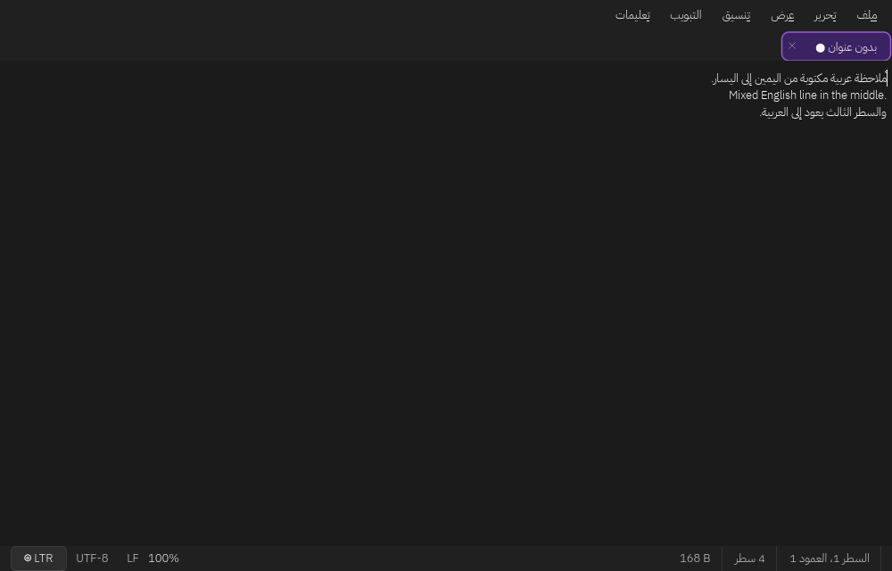
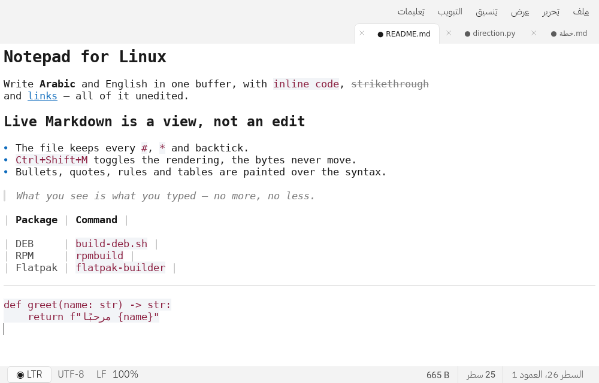
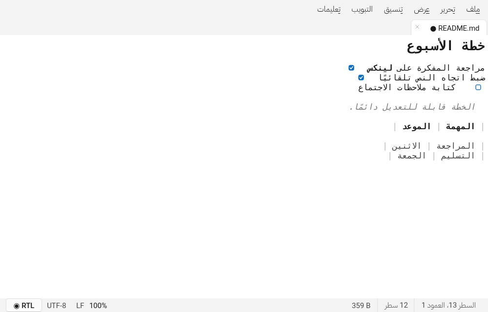
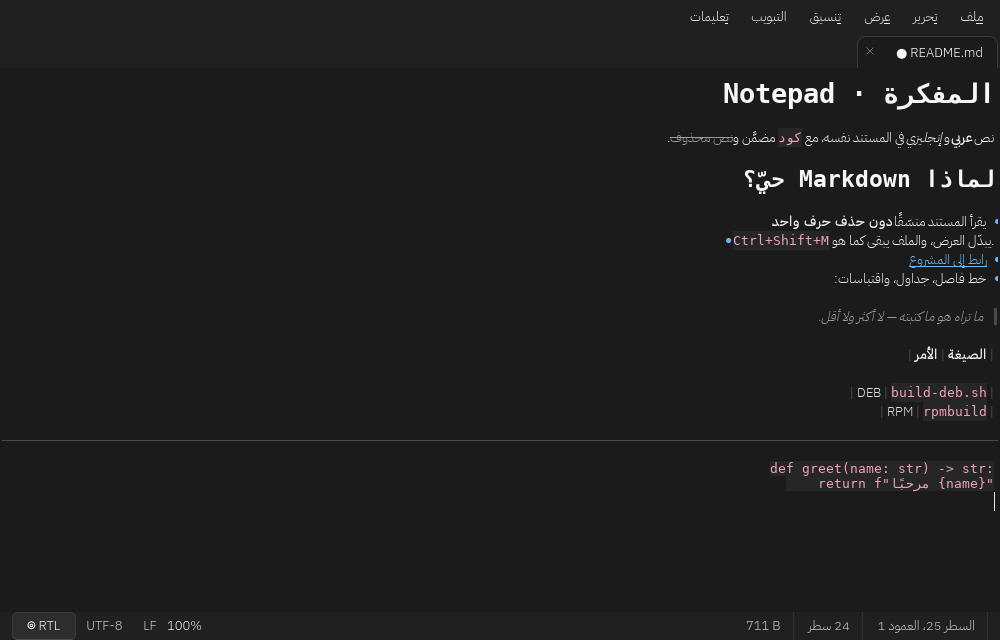
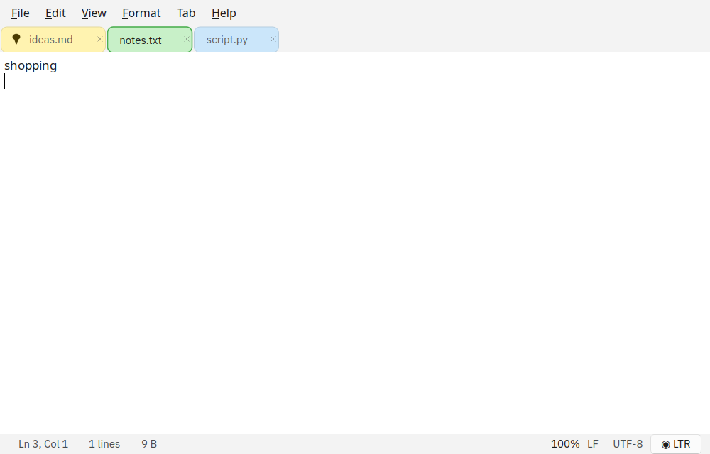
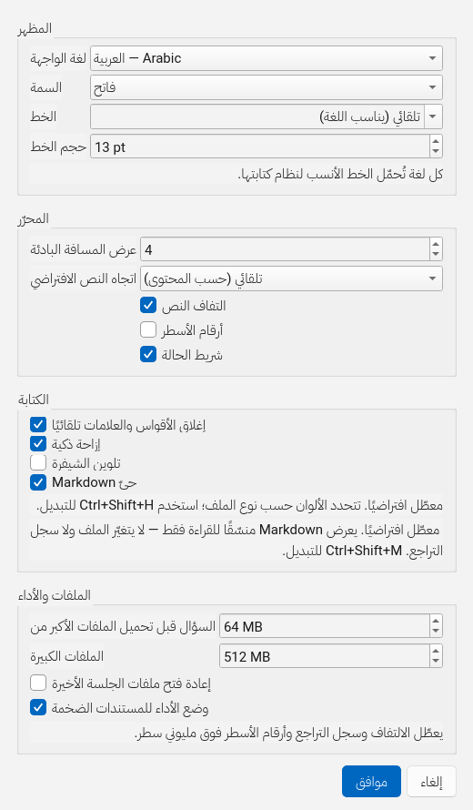
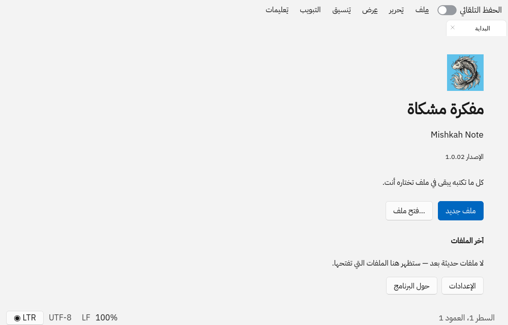
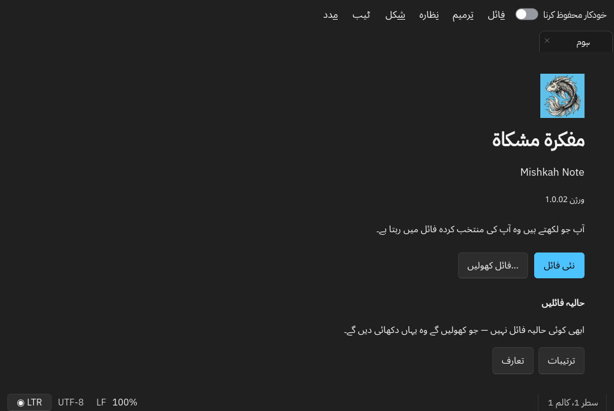

<div align="center">


# مفكرة مشكاة · Mishkah Note

**محرّر نصوص خفيف عربي أوّلًا لنظام Linux وWindows — اتجاه تلقائي، تبويبات ملوّنة، وMarkdown حيّ بلا تعديل للملف.**

*An Arabic-first lightweight text editor for Linux & Windows with automatic per-paragraph RTL/LTR, coloured tabs, and non-destructive live Markdown.*

[](https://github.com/bifa90/Mishkah-Note/releases/latest)
[](https://github.com/bifa90/Mishkah-Note/actions/workflows/ci.yml)
[](LICENSE)
[](pyproject.toml)

<p>
  <a href="https://github.com/bifa90/Mishkah-Note/releases/latest"><strong>⬇ تحميل أحدث إصدار · Download Latest (v1.0.02)</strong></a>
  &nbsp;·&nbsp;
  <a href="#التحميل-والتثبيت--download--installation">التثبيت · Install</a>
  &nbsp;·&nbsp;
  <a href="#لقطات-الشاشة--screenshots">اللقطات · Screenshots</a>
  &nbsp;·&nbsp;
  <a href="#المزايا--features">المزايا · Features</a>
  &nbsp;·&nbsp;
  <a href="#الاختصارات--shortcuts">الاختصارات · Shortcuts</a>
</p>

<br />



</div>

---

## لماذا مفكرة مشكاة؟ · What it is

**مفكرة مشكاة** محرّر نصوص خفيف يفتح فورًا، بواجهة مستوحاة من Windows 11 Notepad، بلا تعقيد ولا شريط أدوات مزدحم: تبويبات ملوّنة، حفظ ذرّي، وبحث سريع. الفرق أنه يبدأ من العربية لا من الإنجليزية — الاتجاه يُحسب تلقائيًا لكل فقرة ومستند، والخط العربي مضمَّن داخل الحزمة، والواجهة نفسها مترجمة إلى عشر لغات.

> A lightweight text editor that opens instantly: tabs, atomic saves, fast search — and text direction resolved naturally per paragraph instead of forced on the whole application. The interface speaks ten languages, and the bundled Arabic & Urdu chrome fonts ship inside the package.

**مناسب لمن:**
* يريد بديلًا خفيفًا وسريعًا لـ Notepad على Linux (KDE · GNOME · Wayland · X11) أو Windows.
* يكتب العربية والإنجليزية في الملف نفسه ويريد أن يظهر كل سطر بالاتجاه الصحيح.
* يفتح ملفات نصّية وسجلّات ضخمة (مئات الميغابايت) دون تجمّد الواجهة.
* يقرأ ويكتب Markdown منسّقًا على الشاشة **دون** تعديل الملف الخام على القرص.

---

## التحميل والتثبيت · Download & Installation

الإصدار الحالي **1.0.02** — جميع الحزم الجاهزة متوفرة في صفحة [**Releases**](https://github.com/bifa90/Mishkah-Note/releases/latest).

### 1. التحميل السريع للمستخدمين · Quick download (no terminal needed)

* **Linux — `AppImage` (يعمل على أي توزيعة بلا تثبيت وبلا Python):**
  1. حمّل `Mishkah_Note-1.0.02-x86_64.AppImage` من [صفحة الإصدارات](https://github.com/bifa90/Mishkah-Note/releases/latest).
  2. انقر عليه بالزر الأيمن ← **الخصائص (Properties)** ← فعّل **السماح بالتشغيل كبرنامج** (أو عبر الطرفية: `chmod +x Mishkah_Note-1.0.02-x86_64.AppImage`).
  3. انقر عليه مرتين لتشغيله فورًا.
* **Windows — `.msi` (تجريبي، بلا Python):**
  حمّل `Mishkah_Note_1.0.02_x64.msi` وانقر عليه مرتين للتثبيت (أو عبر PowerShell: `msiexec /i Mishkah_Note_1.0.02_x64.msi`).

### 2. التثبيت عبر مدير الحزم على Linux · Package managers

| التوزيعة · Distro | الصيغة | أمر التثبيت |
|---|---|---|
| **Debian / Ubuntu** | `.deb` | `sudo apt install ./mishkah-note_1.0.02_all.deb` *(يثبّت `PySide6` و`QtNetwork` تلقائيًا)* |
| **Fedora / RHEL / openSUSE** | `.rpm` | `sudo dnf install ./mishkah-note-1.0.02-1.*.noarch.rpm` |
| **Arch / Manjaro** | `.pkg.tar.zst` | `sudo pacman -U mishkah-note-1.0.02-1-any.pkg.tar.zst` |
| **Flatpak** *(يحتاج `org.kde.Platform//6.7`)* | `.flatpak` | `flatpak install --user org.mishkahnote.Mishkah.flatpak && flatpak run org.mishkahnote.Mishkah` |

<details>
<summary><strong>التثبيت والبناء من المصدر · Build from source & packaging (للمطورين)</strong></summary>

<br />

متطلبات التشغيل: Python ≥ 3.9، PySide6 ≥ 6.5، `charset-normalizer` ≥ 3.0.

```bash
git clone https://github.com/bifa90/Mishkah-Note
cd Mishkah-Note
python3 -m venv .venv && . .venv/bin/activate
pip install -e ".[dev]"
mishkah
```

الاختبارات وفحص التنسيق:

```bash
pytest -q
ruff check src tests tools
```

بناء الحزم محليًا:

```bash
bash scripts/build-deb.sh                     # .deb
bash scripts/build-rpm.sh                     # .rpm   (rpm-build)
bash scripts/build-arch.sh                    # Arch   (makepkg)
bash packaging/appimage/build-appimage.sh     # AppImage (appimagetool)
flatpak-builder --user --install-deps-from=flathub build/flatpak-build \
    packaging/flatpak/org.mishkahnote.Mishkah.json
pwsh scripts/build-msi.ps1 -Version 1.0.02    # MSI على Windows فقط
bash scripts/verify-packaging.sh              # التحقق من الحزم المتاحة على جهازك
```

> سير عمل GitHub يبني الصيغ السبع على Runnerات نظيفة ويرفقها بالإصدار تلقائيًا؛ تفاصيله في [`docs/ci/`](docs/ci/README.md).

</details>

---

## لقطات الشاشة · Screenshots

| السمة الفاتحة · Light | Markdown حيّ · Live Markdown | Markdown الداكن · Dark Markdown |
|---|---|---|
|  |  |  |

| التبويبات الملوّنة · Coloured tabs | الإعدادات · Settings |
|---|---|
|  |  |

صفحة البداية تُبقي الهوية ثابتة بلا ترجمة (الشعار ثم **مفكرة مشكاة** ثم **Mishkah Note** ثم رقم الإصدار) وتضع قائمة **آخر الملفات** في الجهة المعاكسة حسب اتجاه اللغة — الشعار يمينًا وآخر الملفات يسارًا في العربية والأردية، والعكس في الإنجليزية وبقية اللغات.

| البداية — العربية · Welcome, Arabic | البداية — الأردية · Welcome, Urdu |
|---|---|
|  |  |

---

## المزايا · Features

### Markdown حيّ — عرض لا تعديل · Live Markdown, a view and not an edit

`View ▸ Live Markdown` أو `Ctrl+Shift+M`: يُنسّق العناوين (`#`–`######`) والعريض والمائل والمشطوب والشيفرة المضمّنة والكتل والقوائم والاقتباسات والروابط والخطوط الفاصلة والجداول مع إخفاء الرموز تلقائيًا.

* **لا يتغيّر الملف ولو بحرف**: `toPlainText()` يطابق المحتوى على القرص، وسجل التراجع لا يُمسّ — الإيقاف يعيد النص الخام كما كتبته.
* الفقرة التي يقف فيها المؤشر تكشف رموزها بلون خفيف لتسهيل التعديل.
* معطّل افتراضيًا ويُحفظ تفضيلك ويُطبّق على كل تبويب مفتوح.

### الاتجاه واللغات والخطوط · Direction, languages & typography

* **اتجاه تلقائي لكل فقرة** وفق أول حرف قوي (Unicode Bidi)، مع تثبيت يدوي عبر `Format ▸ Direction` (`Ctrl+Shift+A/R/L`) أو `Ctrl+Shift` + يمين/يسار دون تعارض مع تبديل لغة لوحة المفاتيح.
* **10 لغات للواجهة** بتبديل فوري بلا إعادة تشغيل: `en, zh-Hans, hi, es, fr, ar, bn, pt, ru, ur`.
* خط **IBM Plex Sans Arabic Regular** مضمَّن للعربية، و**Noto Sans Arabic** مضمَّن لقوائم الأردية (مع إبقاء النستعليق لمحرر النصوص)، وسلاسل خطوط مخصصة لكل نظام كتابة، مع إمكانية اختيار أي خط مخصص من الإعدادات. [تفاصيل الخطوط](docs/FONTS.md).

### الكتابة والتبويبات والترميز · Writing, tabs & encodings

* إكمال تلقائي للأقواس وعلامات التنصيص `() [] {} "" '' «» “”`، إزاحة ذكية، وإكمال الكلمات (`Ctrl+Space`) من كلمات مستندك نفسه.
* تلوين الشيفرة لـ 16 لغة (`Ctrl+Shift+H`) يتبع السمة الفاتحة أو الداكنة تلقائيًا.
* تبويبات بألوان أوراق الملاحظات (`Ctrl+Shift+K`)، تثبيت التبويب (`Ctrl+Shift+P`)، وإبقاء النافذة فوق التطبيقات (`Alt+T`).
* ترميزات `UTF-8 / UTF-8 BOM / UTF-16 / UTF-32 / Windows-1256 / Windows-1252 / ISO-8859-6 / ISO-8859-1 / CP720 / ASCII` مع كشف تلقائي وإعادة فتح بأي ترميز، وتبديل نهايات الأسطر `LF / CRLF / CR`.

### الملفات الكبيرة والأمان · Large files & data safety

* فحص الترميز على أول 64 KiB وفكّ الملف على دفعات 1 MiB مع شريط تقدّم قابل للإلغاء.
* معاينة سريعة للقراءة فقط للملفات الكبيرة، ووضع أداء تلقائي فوق مليوني سطر.
* **حفظ ذرّي** عبر ملف مؤقت ثم `os.replace`، وحفظ تلقائي اختياري لكل مستند (`Ctrl+Alt+S`)، وتنبيه آمن عند تغيّر الملف خارجيًا على القرص.

---

## الاختصارات · Shortcuts

<details>
<summary><strong>عرض جدول اختصارات لوحة المفاتيح الكامل · Show full keyboard shortcuts</strong></summary>

<br />

| الاختصار | الوظيفة | Action |
|---|---|---|
| `Ctrl+N` · `Ctrl+O` · `Ctrl+S` | جديد · فتح · حفظ | New · Open · Save |
| `Ctrl+Shift+S` · `Ctrl+Shift+N` | حفظ باسم · نافذة جديدة | Save as · New window |
| `Ctrl+T` · `Ctrl+W` · `Ctrl+Tab` | تبويب جديد · إغلاق التبويب · التنقل | New tab · Close tab · Cycle |
| `Ctrl+P` · `Ctrl+Alt+S` | طباعة · الحفظ التلقائي | Print · Autosave |
| `Ctrl+F` · `Ctrl+H` · `F3` / `Shift+F3` | بحث · استبدال · التالي / السابق | Find · Replace · Next / Prev |
| `Ctrl+G` · `F5` · `Ctrl+,` | الانتقال إلى سطر · التاريخ والوقت · الإعدادات | Go to line · Date/time · Settings |
| `Ctrl++` · `Ctrl+-` · `Ctrl+0` | تكبير · تصغير · إعادة ضبط | Zoom in · Zoom out · Reset |
| `Ctrl+Space` | إكمال الكلمة | Word completion |
| **`Ctrl+Shift+M`** | **Markdown حيّ** | **Live Markdown** |
| `Ctrl+Shift+H` | تلوين الشيفرة | Syntax highlighting |
| `Ctrl+Shift+P` · `Alt+T` | تثبيت التبويب · فوق التطبيقات | Pin tab · Always on top |
| `Ctrl+Shift+K` | تدوير لون التبويب | Cycle tab colour |
| **`Ctrl+Shift+→` / `←`** | **اتجاه النص: RTL / LTR** | **Text direction** |
| `Ctrl+Shift+A` · `R` · `L` | اتجاه تلقائي · RTL · LTR | Auto · RTL · LTR |
| `Ctrl+Z` · `Ctrl+Y` / `Ctrl+Shift+Z` | تراجع · إعادة | Undo · Redo |
| `Ctrl+X` · `Ctrl+C` · `Ctrl+V` · `Ctrl+Shift+V` | قص · نسخ · لصق · لصق بلا تنسيق | Cut · Copy · Paste · Paste plain |
| `Tab` · `Shift+Tab` | إزاحة · إزاحة عكسية | Indent · Unindent |

</details>

<details>
<summary><strong>البنية الداخلية للمشروع · Architecture</strong></summary>

<br />

```
src/mishkah/
├── core/        منطق خالص بلا Qt: markdown, syntax, autocomplete, encoding,
│                large_file, text_direction, i18n, settings, tab_style
├── models/      DocumentModel (مسار، ترميز، تعديل، لون، تثبيت)
├── services/    FileService — إدخال/إخراج في خيوط خلفية
├── views/       MainWindow · EditorView · StatusBar
├── widgets/     الحوارات + صفحة البداية + الملوّن + MarkdownDecorator
└── controllers/ MainController — الربط بينها
```

`core/` و`models/` لا تستوردان Qt على مستوى الوحدة، لذا تُختبر بسرعة بلا شاشة.

</details>

---

## الأسئلة الشائعة · FAQ

* **هل يغيّر Markdown الحيّ الملف؟** لا — هو طبقة عرض فقط؛ المحتوى وسجل التراجع يبقيان كما هما، والإيقاف يعيد النص الخام حرفيًا.
* **هل يعمل بلا خطوط عربية على النظام؟** نعم — `IBM Plex Sans Arabic` و`Noto Sans Arabic` مضمَّنان داخل الحزمة.
* **هل يحتاج Python على جهازي؟** `AppImage` و`MSI` **لا يحتاجان Python** (يحملان مفسّر Python ومكتبات PySide6 داخلهما). أما `.deb` و`.rpm` و`.pkg.tar.zst` فتستخدم حزم النظام، وFlatpak يعتمد على `org.kde.Platform`.

---

## القيود المعروفة · Known limitations

نذكرها بوضوح قبل التنزيل:

| القيد | التفصيل |
|---|---|
| **الوصولية حدّ أدنى** | أسماء للعناصر التي لا نص لها وترتيب `Tab` واضح، لكن **لم يُجرَّب مع Orca** ولا توجد مراجعة وصولية كاملة بعد. |
| **ثماني ترجمات آلية** | العربية والإنجليزية يدويّتان؛ الصينية والهندية والإسبانية والفرنسية والبنغالية والبرتغالية والروسية والأردية **آلية ولم يراجعها متحدّث أصلي**. |
| **لا تصدير** | Markdown عرض حيّ فقط — لا تصدير إلى HTML أو PDF. |
| **جلسة بنافذة واحدة** | النافذة الأولى وحدها تحفظ قائمة التبويبات المفتوحة عند الإغلاق. |
| **لا استرداد لتبويب بلا مسار** | الملفات المحفوظة محميّة؛ تبويب جديد لم يُحفظ بعد يُفقد إن أُغلق البرنامج بانهيار. |
| **لا بحث عبر التبويبات** | البحث داخل التبويب الحالي فقط. |
| **Flatpak بصلاحية `home`** | لا portals، ولم يُقدَّم إلى Flathub في 1.0.02. |
| **غير مُجرَّب بالكامل** | إدخال العربية على Wayland/IBus · طابعات حقيقية · التثبيت بـ`apt`/`dnf`/`pacman` على أجهزة مستخدمين متنوعة. |

التفصيل الكامل في [ملاحظات الإصدار](docs/RELEASE_NOTES.md) وما هو مؤجّل للإصدار القادم في [خارطة الطريق](docs/ROADMAP.md).

---

## المساهمة والرخصة · Contributing & License

المساهمات مرحّب بها: [CONTRIBUTING.md](CONTRIBUTING.md) · [SECURITY.md](SECURITY.md) · [docs/DEVELOPMENT.md](docs/DEVELOPMENT.md) · [docs/PACKAGING.md](docs/PACKAGING.md) · [docs/FONTS.md](docs/FONTS.md).

رخصة **MIT** — راجع [LICENSE](LICENSE). الخطوط المضمَّنة تحت **SIL OFL 1.1**، ويعمل التطبيق على **Qt 6 / PySide6** (**LGPL v3**) و**charset-normalizer** (MIT)، ويحزم في AppImage وMSI مفسّر **CPython** (رخصة PSF). التفاصيل وإشعارات الطرف الثالث في [THIRD-PARTY-NOTICES.md](THIRD-PARTY-NOTICES.md).
