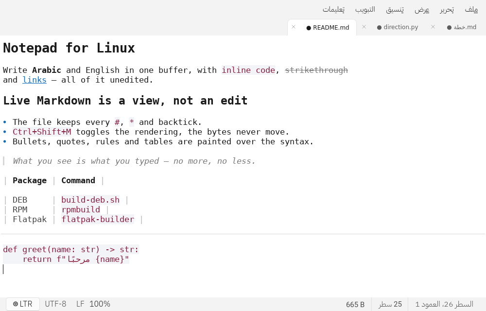
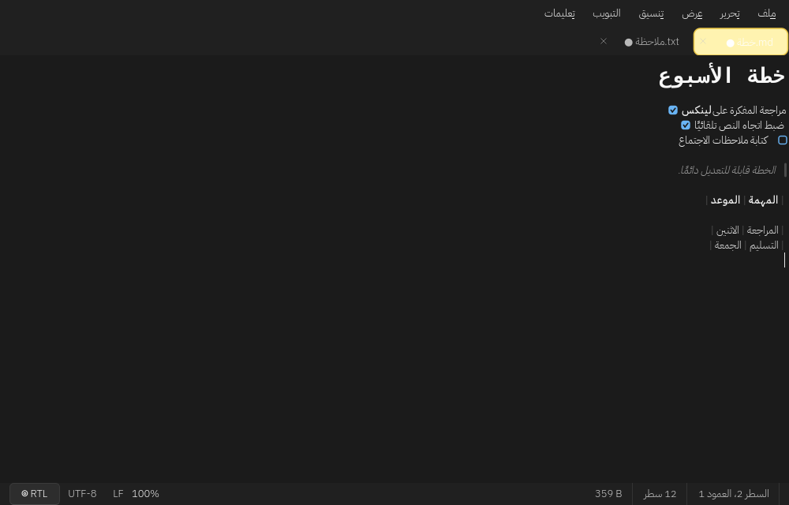
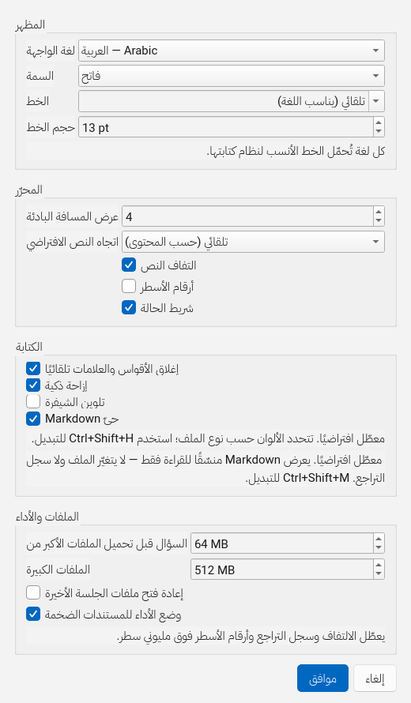
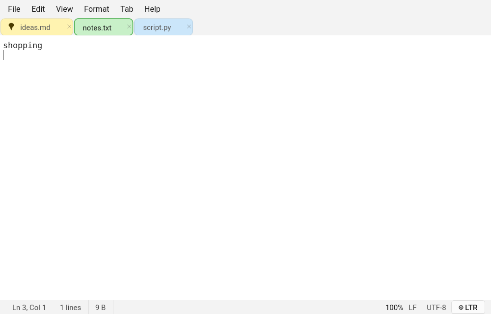
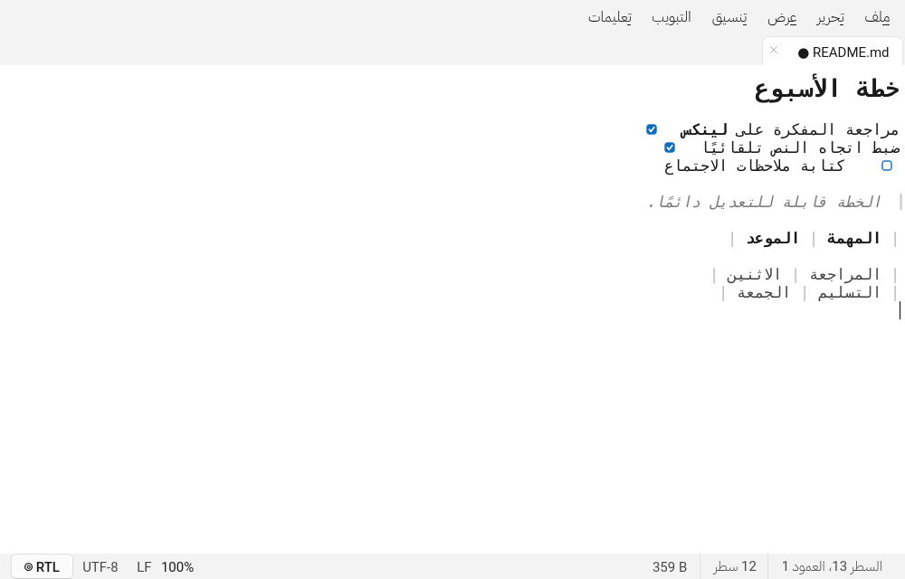

<div align="center">


# المفكرة · Notepad for Linux

**محرّر نصوص لسطح مكتب لينكس بواجهة Windows 11، عربي أولًا وقارئ لكل لغة.**
A fast, Windows 11-style text editor for the Linux desktop — built for Arabic
and every other script.

[](LICENSE)
[](pyproject.toml)
[](https://www.qt.io)
[](#التثبيت--installation)

[المزايا](#المزايا--features) ·
[التثبيت](#التثبيت--installation) ·
[الاختصارات](#الاختصارات--shortcuts) ·
[البناء من المصدر](#البناء-من-المصدر--build-from-source) ·
[الأسئلة الشائعة](#الأسئلة-الشائعة--faq)

</div>



---

## ما هو؟ · What it is

**المفكرة** محرّر نصوص خفيف يفتح فورًا، بلا مشروع ولا شريط أدوات مزدحم: تبويبات،
حفظ ذرّي، وبحث سريع. الفرق أنه يبدأ من العربية لا من الإنجليزية — الاتجاه يُحسب
لكل مستند على حدة، والخط العربي مضمَّن مع البرنامج، والواجهة نفسها مترجمة إلى
عشر لغات.

> A notepad that opens instantly: tabs, atomic saves, fast search — and a text
> direction that is resolved per document instead of forced on the whole
> application. The interface speaks ten languages; the Arabic typeface ships
> inside the package.

### لمن؟ · Who it is for

* من يكتب العربية والإنجليزية في الملف نفسه ويريد أن يظهر كلٌّ منهما صحيحًا.
* من يفتح ملفات سجلّ كبيرة (مئات الميغابايت) ولا يريد أن يتجمّد المحرّر.
* من يريد محرّرًا صغيرًا يعرف Markdown ويقرأه منسّقًا **دون** أن يلمس الملف.
* من يعمل على KDE أو GNOME أو Wayland أو X11، بسمة فاتحة أو داكنة.

| الوضع الداكن · Dark | الإعدادات · Settings | التبويبات الملوّنة · Coloured tabs |
|---|---|---|
|  |  |  |

---

## المزايا · Features

### Markdown حيّ — عرض لا تعديل · Live Markdown, a view and not an edit

`View ▸ Live Markdown` أو `Ctrl+Shift+M`: تُنسَّق العناوين والعريض والمائل
والمشطوب والشيفرة المضمَّنة والكتل والأقواس والجداول والفواصل، وتُخفى الرموز
(`#`، `**`، `` ` ``، `-`، `>`، `[]()`) فيبقى النص مصمَّمًا بلا رموز.

* **لا يتغيّر الملف ولو بحرف**: `toPlainText()` يبقى مطابقًا للمحتوى على القرص،
  وسجل التراجع لا يُمسّ — الإيقاف يعيد النص الخام كما كتبته تمامًا.
* الفقرة التي فيها المؤشر تكشف رموزها مؤقتًا (بلون باهت) لتتمكن من التعديل.
* **معطّل افتراضيًا**، ويُحفظ تفضيلك ويُطبَّق على كل تبويب مفتوح.
* مدعوم كحد أدنى: عناوين `#`–`######`، عريض/مائل/يتوسطه خط، `inline code`
  وكتل ```` ``` ````، قوائم مرقّمة ونقطية، اقتباس `>`، روابط، خط فاصل، جداول.



### الاتجاه واللغة · Direction and language

* الاتجاه **تلقائي** افتراضيًا: يُستنتج من أول حرف قوي في الفقرة، مثل Unicode
  Bidi Algorithm ومثل Notepad في Windows 11.
* يمكن تثبيته من `Format ▸ Direction` (`Ctrl+Shift+A/R/L`) أو من شريحة شريط
  الحالة، و`Ctrl+Shift` + يمين/يسار يبدّل الاتجاه فورًا — دون تعارض مع تبديل
  لوحة المفاتيح في النظام.
* عشر لغات للواجهة: `en, zh-Hans, hi, es, fr, ar, bn, pt, ru, ur`، وتبديلها
  فوري بلا إعادة تشغيل.
* خط **IBM Plex Sans Arabic** مضمَّن (SIL OFL 1.1)، وسلسلة خطوط مناسبة لكل
  نظام كتابة: Devanagari للهندية، Bengali للبنغالية، وCJK للصينية.

### الكتابة · Writing

* **إكمال تلقائي للأقواس والعلامات** `() [] {} "" '' «» “”`، مع تخطّي القوس
  المكرر ولفّ التحديد المظلّل.
* `Backspace` بين قوسين فارغين يحذفهما معًا.
* **إزاحة تلقائية** تحافظ على المستوى وتزيده بعد فتح كتلة، وتتبع أسلوب الملف
  (Tab أو مسافتان أو أربع).
* `Tab` / `Shift+Tab` يزيحان الكتلة المحدّدة.
* **إكمال الكلمات** بـ`Ctrl+Space` من كلمات مستندك نفسه، بالعربية والإنجليزية.

### الملفات الكبيرة · Large files

* فحص الترميز على أول 64 KiB، ثم فكّه على دفعات 1 MiB مع شريط تقدّم وإلغاء.
* فوق 8 MiB: معاينة للقراءة فقط (اختيارية)، وفوق 512 MiB: تأكيد صريح.
* فوق مليوني سطر: **وضع الأداء** يعطّل الالتفاف وسجل التراجع ويخفي أرقام
  الأسطر تلقائيًا.
* **حفظ ذرّي**: الكتابة إلى ملف مؤقت ثم `os.replace`، فلا يبقى ملف نصف مكتوب.

### الترميز والتبويبات · Encodings and tabs

* UTF-8، UTF-8 مع BOM، UTF-16 LE/BE، UTF-32، Windows-1256/1252، ISO-8859-6/1،
  CP720، ASCII — مع كشف تلقائي وإعادة فتح بترميز آخر.
* نهايات الأسطر LF / CRLF / CR، وتبديلها من شريط الحالة.
* ألوان تبويبات على نمط أوراق الملاحظات (`Ctrl+Shift+K` للتدوير)، وتثبيت
  التبويب فوق التطبيقات (`Ctrl+P`).
* تلوين الشيفرة **اختياري ومعطّل افتراضيًا** (`Ctrl+Shift+H`)، لأربعة عشر لغة،
  وتتبعه السمة الفاتحة أو الداكنة.

---

## التثبيت · Installation

الإصدار الحالي **1.0.01**. تنزيل الصيغ الجاهزة من صفحة
[Releases](https://github.com/bifa90/Notepad-Linux/releases).

### Debian / Ubuntu · `.deb`

```bash
sudo apt install ./notepad-linux_1.0.01_all.deb
notepad
```

### Fedora / RHEL / openSUSE · `.rpm`

```bash
sudo rpm -i notepad-linux-1.0.01-1.noarch.rpm
# أو: sudo dnf install ./notepad-linux-1.0.01-1.noarch.rpm
```

### Arch / Manjaro · `.pkg.tar.zst`

```bash
sudo pacman -U notepad-linux-1.0.01-1-any.pkg.tar.zst
```

أو من `PKGBUILD` مباشرة:

```bash
cd packaging/arch && makepkg -si
```

### AppImage — محمول بلا تثبيت · portable

```bash
chmod +x Notepad-1.0.01-x86_64.AppImage
./Notepad-1.0.01-x86_64.AppImage
```

### Flatpak

```bash
flatpak install --user org.notepadlinux.Notepad.flatpak
flatpak run org.notepadlinux.Notepad
```

> Flatpak يحتاج `org.kde.Platform//6.7` من Flathub.
> Flatpak needs the KDE runtime from Flathub.

### Windows · `.msi`

```powershell
msiexec /i Notepad-1.0.01-x64.msi
```

### من المصدر · From source

```bash
git clone https://github.com/bifa90/Notepad-Linux
cd Notepad-Linux
python3 -m venv .venv && . .venv/bin/activate
pip install .
notepad            # أو: mufakkira
```

متطلبات: Python ≥ 3.9، PySide6 ≥ 6.5، `charset-normalizer` ≥ 3.0.

---

## الاختصارات · Shortcuts

| الاختصار | الوظيفة | Action |
|---|---|---|
| `Ctrl+N` · `Ctrl+O` · `Ctrl+S` | جديد · فتح · حفظ | New · Open · Save |
| `Ctrl+Shift+S` | حفظ باسم | Save as |
| `Ctrl+W` · `Ctrl+Tab` | إغلاق التبويب · التنقل | Close tab · cycle |
| `Ctrl+F` · `Ctrl+H` · `F3` | بحث · استبدال · التالي | Find · Replace · Next |
| `Ctrl+G` | الانتقال إلى سطر | Go to line |
| `Ctrl++` · `Ctrl+-` · `Ctrl+0` | تكبير · تصغير · إعادة ضبط | Zoom |
| `F5` | التاريخ والوقت | Date and time |
| `Ctrl+,` | الإعدادات | Settings |
| `Ctrl+Space` | إكمال الكلمة | Word completion |
| **`Ctrl+Shift+M`** | **Markdown حيّ** | **Live Markdown** |
| `Ctrl+Shift+H` | تلوين الشيفرة | Syntax highlighting |
| `Ctrl+P` · `Ctrl+T` | تثبيت التبويب · فوق التطبيقات | Pin tab · always on top |
| `Ctrl+Shift+K` | تدوير لون التبويب | Cycle tab colour |
| **`Ctrl+Shift+→` / `←`** | **اتجاه النص: RTL / LTR** | **Text direction** |
| `Ctrl+Shift+A` | اتجاه تلقائي | Automatic direction |

---

## البناء من المصدر · Build from source

```bash
pip install -e ".[dev]"
python -m mufakkira
pytest -q                      # 273 اختبارًا
ruff check src tests tools
```

### الحزم · Packages

```bash
bash scripts/build-deb.sh                     # .deb
bash scripts/build-rpm.sh                     # .rpm   (rpm-build)
bash scripts/build-arch.sh                    # Arch   (makepkg)
bash packaging/appimage/build-appimage.sh     # AppImage (appimagetool)
flatpak-builder --user --install-deps-from=flathub build/flatpak-build \
    packaging/flatpak/org.notepadlinux.Notepad.json
pwsh scripts/build-msi.ps1 -Version 1.0.01    # MSI على Windows فقط
```

للتحقق من كل ما تسمح به أدوات جهازك:

```bash
bash scripts/verify-packaging.sh
```

سير عمل GitHub يبني الصيغ السبع على Runnerات نظيفة ويرفقها بالإصدار؛ ملفاته في
[`docs/ci/`](docs/ci/README.md) لأن صلاحية الأتمتة هنا لا تكتب
`.github/workflows/`.

### البنية · Architecture

```
src/mufakkira/
├── core/        منطق خالص بلا Qt: markdown, syntax, autocomplete, encoding,
│                large_file, text_direction, i18n, settings, tab_style
├── models/      DocumentModel (مسار، ترميز، تعديل، لون، تثبيت)
├── services/    FileService — إدخال/إخراج في خيوط خلفية
├── views/       MainWindow · EditorView · StatusBar
├── widgets/     الحوارات + الملوّن + MarkdownDecorator
└── controllers/ MainController — الربط بينها
```

`core/` و`models/` لا تستوردان Qt على مستوى الوحدة، لذا تُختبر بلا شاشة.

---

## الأسئلة الشائعة · FAQ

**هل يغيّر Markdown الملف؟**
لا. هو طبقة عرض فوق المحرّر؛ المحتوى وسجل التراجع يبقيان كما هما، والإيقاف
يعيد النص الخام حرفيًا.

**هل يعمل بلا خطوط عربية على النظام؟**
نعم — IBM Plex Sans Arabic مضمَّن داخل الحزمة.

**هل يفتح ملفات ضخمة؟**
نعم، على دفعات مع شريط تقدّم وإلغاء، ووضع أداء تلقائي فوق مليوني سطر.

**هل يحتاج Python؟**
`MSI` لا يحتاج Python إطلاقًا. `.deb` و`.rpm` و`.pkg.tar.zst` تطلب
`python3` و`python3-pyside6` من مستودع التوزيعة، و`AppImage` يستخدم `python3`
الموجود على النظام، وFlatpak يوفّره من بيئة التشغيل `org.kde.Platform`.

**هل توجد نسخة Windows أصلية؟**
نعم، عبر MSI مبني بـWiX فوق نسخة مجمّدة بـPyInstaller — دون Python على الجهاز.

---

## المساهمة · Contributing

المساهمات مرحّب بها: [CONTRIBUTING.md](CONTRIBUTING.md) · [SECURITY.md](SECURITY.md).
تفاصيل التطوير في [docs/DEVELOPMENT.md](docs/DEVELOPMENT.md)، والتغليف في
[docs/PACKAGING.md](docs/PACKAGING.md)، والخطوط في [docs/FONTS.md](docs/FONTS.md).

## الرخصة · License

MIT — راجع [LICENSE](LICENSE). خط IBM Plex Sans Arabic المضمَّن تحت
SIL OFL 1.1، وتفاصيله في [docs/FONTS.md](docs/FONTS.md).
