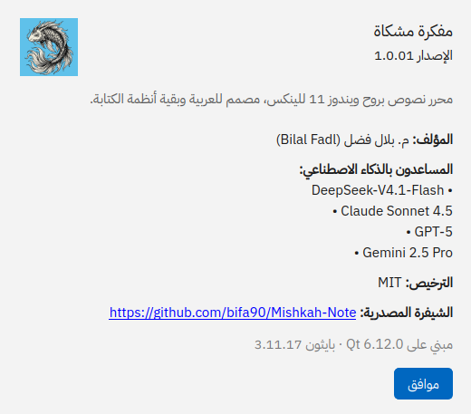

# دليل التطوير · Development guide

## تشغيل البيئة · Setting up

```bash
python3 -m venv .venv && . .venv/bin/activate
pip install -e ".[dev]"
```

تشغيل التطبيق:

```bash
python -m mishkah            # أو: mishkah
python -m mishkah README.md  # فتح ملف مباشرة
mishkah --safe-mode            # بإعدادات افتراضية وجلسة فارغة
```

## الاختبارات · Tests

```bash
pytest                        # كل الاختبارات
pytest -m "not gui"           # المنطق الخالص فقط (بلا Qt)
pytest tests/test_editor_direction.py -v
```

### بلا شاشة · Headless

```bash
QT_QPA_PLATFORM=offscreen pytest
```

### ملاحظة عن إنهاء العمليات · Known teardown note

على بعض الأنظمة (PySide6 6.12 مع Python 3.11) يُنهي المفسّر نفسه بـ:

```
Fatal Python error: bool_dealloc: deallocating True or False
```

بعد أن تنجح **كل** الاختبارات. السبب خلل في تفكيك كائنات الربط أثناء التجميع
النهائي للذاكرة (final GC)، وليس في التطبيق: كل assertions مرّت، والمخرج قبل
الإنهاء سليم، ولا يظهر الخلل عند تعريف أصناف إضافية في السكربت، ولا مع عدد
أقل من الودجات.

للحصول على رمز خروج حتمي في CI:

```bash
MISHKAH_CLEAN_EXIT=1 QT_QPA_PLATFORM=offscreen pytest
```

هذا المتغيّر يجعل `tests/conftest.py` يُفرِّغ المخازن المؤقتة ثم يخرج عبر
`os._exit(status)` بعد انتهاء الجلسة، فلا يدخل CPython مرحلة التفكيك التي
تُسبّب الانهيار. لا يُفعَّل تلقائيًا كي لا يخفي أخطاء حقيقية في بيئات أخرى.

## البنية · Layout

| المسار | المسؤولية | يستورد Qt؟ |
|--------|-----------|-------------|
| `core/` | اتجاه النص، الترميز، الملفات الكبيرة، اللغات، الترجمة، الإعدادات | لا |
| `models/` | حالة المستند | لا |
| `services/` | إدخال/إخراج في خيوط خلفية | نعم (QThread/Signal) |
| `views/` | النافذة، المحرّر، شريط الحالة | نعم |
| `widgets/` | الحوارات | نعم |
| `controllers/` | الربط بين الطبقات | نعم |

## أدوات الكتابة · Editing aids

| الملف | المسؤولية |
|-------|-----------|
| `core/autocomplete.py` | قواعد الإقران والإزاحة وإكمال الكلمات (بلا Qt) |
| `core/syntax.py` | جداول قواعد 16 لغة (بلا Qt) |
| `widgets/syntax_highlighter.py` | تحويل الجداول إلى ألوان عبر QSyntaxHighlighter |
| `core/tab_style.py` | ألوان الملاحظات الستة |
| `core/markdown.py` | تحليل Markdown إلى مقاطع نصية منسّقة (بلا Qt) |
| `widgets/markdown_decorator.py` | عرض Markdown الحيّ: `QSyntaxHighlighter` + رسّام |
| `tools/make_screenshots.py` | توليد لقطات README من الواجهة الحقيقية |

### Markdown الحيّ · Live Markdown

المبدأ: **العرض لا يكتب في المستند**. `core/markdown.py` يُرجع لكل سطر
`(start, end, style, hidden, collapse)`؛ والودجة تُخفي الرموز بتنسيقات محارف
فقط:

* `collapse=True` → لون الخلفية + `letter-spacing = -advance / length`، فيصبح
  عرض الرمز صفرًا حرفيًا (`**bold**` يُرسم بعرض `bold` نفسه، والبكسل متطابق).
* `collapse=False` → إخفاء مع حفظ العرض، ثم يُرسم الرمز البديل في مكانه
  (النقطة `•` بدل `-`، والشريط `▏` بدل `>`).

الفقرة التي فيها المؤشر تُظهر رموزها باهتة كي يسهل التعديل. لا تُعدّل
`toPlainText()` ولا `QTextCursor` ولا مستند Qt إطلاقًا.

## إضافة صيغة Markdown

أضف النمط في `core/markdown.py` (دالة `parse_line`) كمقطع `Span`، ثم أضف
تنسيقه في `_format` داخل `widgets/markdown_decorator.py`، وأضف حالة في
`tests/test_markdown.py`. الاختبارات تقرأ `QTextLayout.formats()` لأن
`QPlainTextEdit` يبني مقاطعه بتأخير.

القاعدة: كل سلوك جديد يوضع في `core/` أولًا مع اختبار، ثم يُربط بالودجة.
التلوين معطّل افتراضيًا عبر `settings.syntax_highlighting`؛ لا تجعله افتراضيًا
دون طلب صريح من صاحب المشروع.

## إضافة لغة تلوين · Adding a highlighted language

1. أضف `LanguageSpec` في `core/syntax.py` (التعابير النمطية + الامتدادات).
2. أضف مجموعة ألوان جديدة في `PALETTE` داخل `widgets/syntax_highlighter.py`
   إن احتجت مجموعة غير الموجودة.
3. أضف حالة إلى `tests/test_syntax.py` — الاختبار يتحقق من أن كل قاعدة تُترجم.

## إضافة ترجمة · Adding a translation

1. أضف رمز اللغة إلى `_LANGUAGES` في `core/languages.py` (مع حزمة الخطوط
   واتجاه الكتابة).
2. أضف الرمز إلى كل جدول في `core/i18n_data.py`.
3. `pytest tests/test_widgets.py::test_every_string_exists_in_every_language`
   سيكشف أي مفتاح ناقص.

## التكامل المستمر · Continuous integration

سيرا العمل جاهزان في `docs/ci/`:

| الملف | الوظيفة |
|-------|---------|
| `ci.yml` | `ruff` + `pytest` على Python 3.9/3.11/3.13، ثم بناء الحزم والتحقق منها |
| `release.yml` | عند دفع وسم `v*`: بناء `.deb` و`.rpm` و`.pkg.tar.zst` و`.AppImage` و`.flatpak` و`.msi` ورفعها بالإصدار |

لم يُوضعا تحت `.github/workflows/` لأن صلاحية الدفع الحالية لا تسمح بذلك.
لتفعيلهما:

```bash
mkdir -p .github/workflows
cp docs/ci/ci.yml docs/ci/release.yml .github/workflows/
git add .github/workflows && git commit -m "ci: enable the workflows" && git push
```

## الشعار والأيقونة · Logo and icon

الشعار المتجهي هو المصدر الوحيد: `src/mishkah/resources/branding/logo.svg`
(والنسخة النقطية `logo.webp` للتوثيق فقط). لا تُحرّر ملفات `icons/app-*.png`
يدويًا — أعد توليدها:

```bash
QT_QPA_PLATFORM=offscreen python tools/make_icon.py
```

يستخدم المولّد اقتصاصًا أضيق للأحجام 16–32 بكسل كي يبقى الشكل واضحًا في
شريط المهام، والشكل الكامل من 48 بكسل فما فوق.

## الأيقونة · The icon

الأيقونة مرسومة برمجيًا، لا صورة مولّدة، لتكون قابلة للمراجعة وإعادة التوليد:

```bash
python tools/make_icon.py
```

يُخرج `app.svg` و`app-16…512.png` و`app.ico` في
`src/mishkah/resources/icons/`.

## التغليف · Packaging

راجع [PACKAGING.md](PACKAGING.md). البناء والتحقق:

```bash
scripts/build-all.sh             # كل صيغة تتوفر أداتها
scripts/build-deb.sh             # .deb فقط
scripts/verify-packaging.sh      # بناء + فحص كل ما يمكن فحصه
```

## نافذة حول التطبيق


