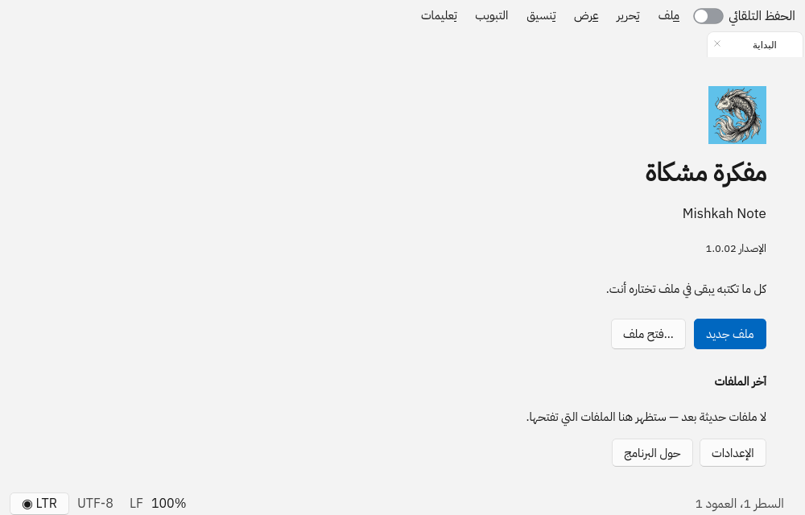
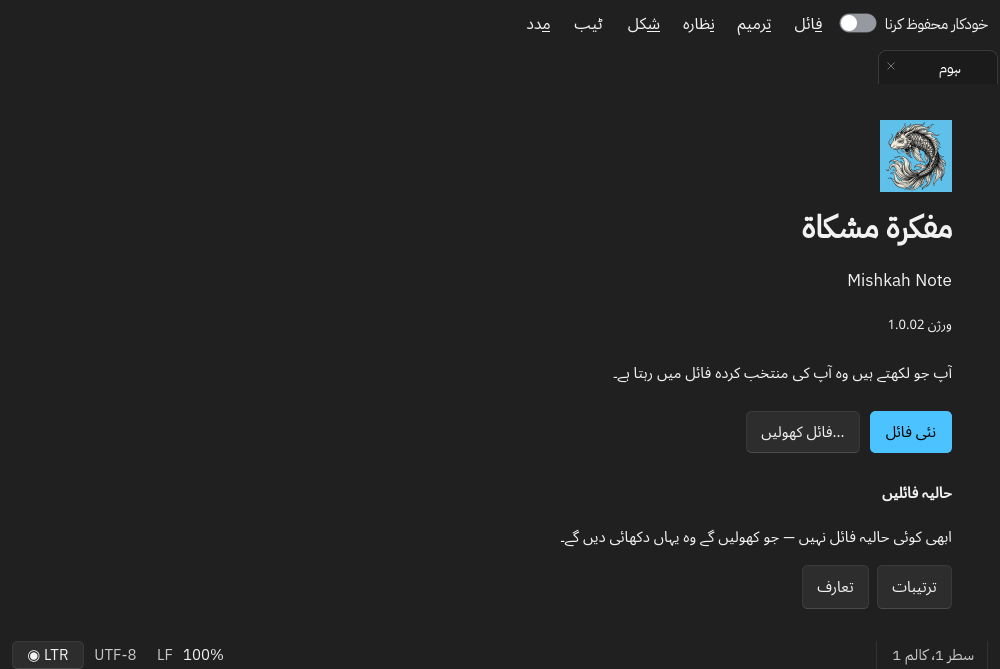

# الخطوط · Fonts

## خطّا الواجهة: الكتابة والقوائم · Two faces per language

لكل لغة خطّان، وليس خطًّا واحدًا:

* **خط الكتابة** (`fonts`) يُستخدم داخل المحرّر حيث يقرأ المستخدم نصًّا طويلًا
  ويحتاج الزخرفة والارتفاع المريح للحرف.
* **خط الواجهة** (`ui_faces`) يُستخدم في شريط القوائم والأزرار والقوائم
  المنسدلة و الألسنة، حيث الحجم 11–13 بكسل: هنا يُشترط الوضوح لا الزخرفة.

الفرق يظهر في الأردية: النستعليق خط كتابة ممتاز، لكنه غير صالح لقائمة بارتفاع
أحد عشر بكسل لأن ذيوله تصطدم بالسطر التالي؛ لذلك واجهة الأردية تستخدم
**Noto Sans Arabic (مضمّن)** بينما يبقى المحرّر على **Noto Nastaliq Urdu**.
مفتاح الخيار في `core/languages.py`: `Language.ui_faces`، وإن كان فارغًا
ورث `Language.fonts`.

|  |  |
|---|---|
| العربية: الاسم والنسخة إلى اليمين | الأردية: القوائم بخط Noto Sans Arabic |

## خط الكتابة التلقائي

اختيار «تلقائي» في **الإعدادات ← الخط** يضع خط القراءة المناسب للغة الواجهة
أولًا، دون تقديم الخطوط أحادية العرض عليه. هذه ترشيحات للوضوح والاتساق؛
لا يوجد خط رسمي إلزامي لكل لغة ولا حكم جمالي يناسب جميع المستخدمين.

| لغة الواجهة | خط الكتابة المفضّل | البدائل عند عدم توفره |
|---|---|---|
| العربية `ar` | **IBM Plex Sans Arabic — Regular (مضمّن)** | Noto Naskh Arabic، Amiri، Noto Sans Arabic، Tahoma |
| الإنجليزية `en` | Noto Sans | Segoe UI، Liberation Sans، DejaVu Sans |
| الإسبانية `es` | Noto Sans | Segoe UI، Liberation Sans، DejaVu Sans |
| الفرنسية `fr` | Noto Sans | Segoe UI، Liberation Sans، DejaVu Sans |
| البرتغالية `pt` | Noto Sans | Segoe UI، Liberation Sans، DejaVu Sans |
| الروسية `ru` | Noto Sans | PT Sans، Segoe UI، Liberation Sans |
| الصينية المبسطة `zh-Hans` | Noto Sans CJK SC | Microsoft YaHei، Source Han Sans SC، WenQuanYi Micro Hei |
| الهندية `hi` | Noto Sans Devanagari | Nirmala UI، Mangal، Lohit Devanagari |
| البنغالية `bn` | Noto Sans Bengali | Nirmala UI، Lohit Bengali، Bangla MN |
| الأردية `ur` | Noto Nastaliq Urdu (للكتابة؛ واجهتها Noto Sans Arabic) | Jameel Noori Nastaleeq، Urdu Typesetting، Noto Naskh Arabic، IBM Plex Sans Arabic |

IBM Plex Sans Arabic مضمّن ويُسجّل عند بدء التطبيق. الخطوط الأخرى ترشيحات
لخطوط النظام، وليست مضمّنة أو منزّلة تلقائيًا؛ يختار Qt البديل المتاح عند
غيابها. يبقى IBM Plex Sans Arabic ضمن بدائل المحرّر لكل اللغات للنصوص المختلطة.
اختيار العائلة مرتبط بلغة الواجهة، وليس كشفًا تلقائيًا للغة كل مستند؛
يتولى Qt بدائل المحارف عند مزج أنظمة الكتابة.

## أساس الترشيح · Sources

- [IBM Plex — المصدر الرسمي والترخيص](https://github.com/IBM/plex): عائلة مفتوحة
  تدعم العربية، مع وزن Regular مضمّن للكتابة اليومية.
- [توصيات Noto للاستخدام](https://notofonts.github.io/noto-docs/website/use/):
  Noto Sans للاتينية والسيريلية، ونسخ نظام الكتابة للمستندات الهندية والبنغالية.
- [Noto CJK](https://github.com/notofonts/noto-cjk): خطوط الصينية واليابانية والكورية.
- [Noto Nastaliq](https://github.com/notofonts/nastaliq): عائلة متخصصة للكتابة بالنستعليق.

## التثبيت السريع · Quick install

```bash
# Debian / Ubuntu
sudo apt install fonts-noto-core fonts-noto-cjk fonts-liberation

# Fedora
sudo dnf install google-noto-sans-fonts google-noto-sans-cjk-fonts liberation-fonts

# Arch
sudo pacman -S noto-fonts noto-fonts-cjk ttf-liberation
```

## الخط المضمَّن · Bundled typeface

يُضمَّن خطّان ويتسجّلان عند بدء التشغيل عبر
`QFontDatabase.addApplicationFont()`، لذا تظهر العربية والأردية بشكل صحيح حتى
على نظام بلا أي خط عربي:

| الملف | العائلة | يستخدمه | الرخصة |
|---|---|---|---|
| `IBMPlexSansArabic-Regular.ttf` | IBM Plex Sans Arabic | واجهة العربية وكتابتها، وبديل أخير لكل اللغات | SIL OFL 1.1 — `OFL.txt` |
| `IBMPlexSansArabic-Light.ttf` | IBM Plex Sans Arabic Light | وزن خفيف داخل الموارد | SIL OFL 1.1 — `OFL.txt` |
| `NotoSansArabic-Regular.ttf` | Noto Sans Arabic | واجهة الأردية (القوائم والأزرار) | SIL OFL 1.1 — `OFL-NotoSansArabic.txt` |

* المصدر: <https://github.com/IBM/plex> و
  <https://github.com/googlefonts/noto-fonts> (`hinted/ttf/NotoSansArabic/`).
* بصمة `NotoSansArabic-Regular.ttf` (SHA-256):
  `ceea25b464a656dc3b26849bab9356740401af62aedf1bfa8b7f0d9b75925b1b`
* الخطوط المضمّنة تغطي محارف الأردية الخاصة (`ٹ ڈ ڑ ں ے ھ`) وهو ما يتحقق منه
  `tests/test_fonts.py` مقابل الحرف نفسه، لا مقابل اسم العائلة فقط.

## تجاوز يدوي · Manual override

`الإعدادات ← الخط` متاح لكل المستخدمين في اللغات العشر، ويتيح اختيار أي خط
مثبّت على النظام، بما فيه الخطوط أحادية العرض. يُحفظ اختيار المستخدم ويظل
مقدّمًا على الترشيحات عند تبديل لغة الواجهة؛ اختيار «تلقائي» يعيد ترشيح اللغة. عند تركه على
«تلقائي» تُستخدم حزمة اللغة الحالية، وهو الخيار الموصى به لأنه يتبع نظام
الكتابة تلقائيًا عند تبديل لغة الواجهة.
